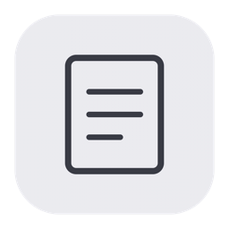
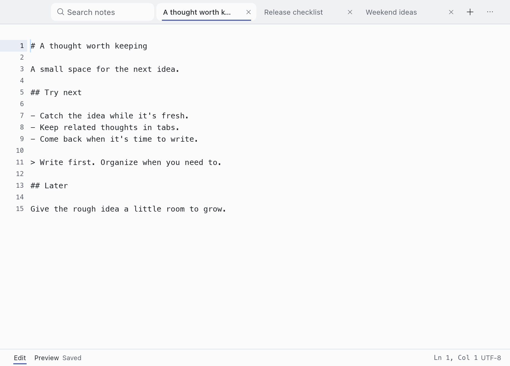
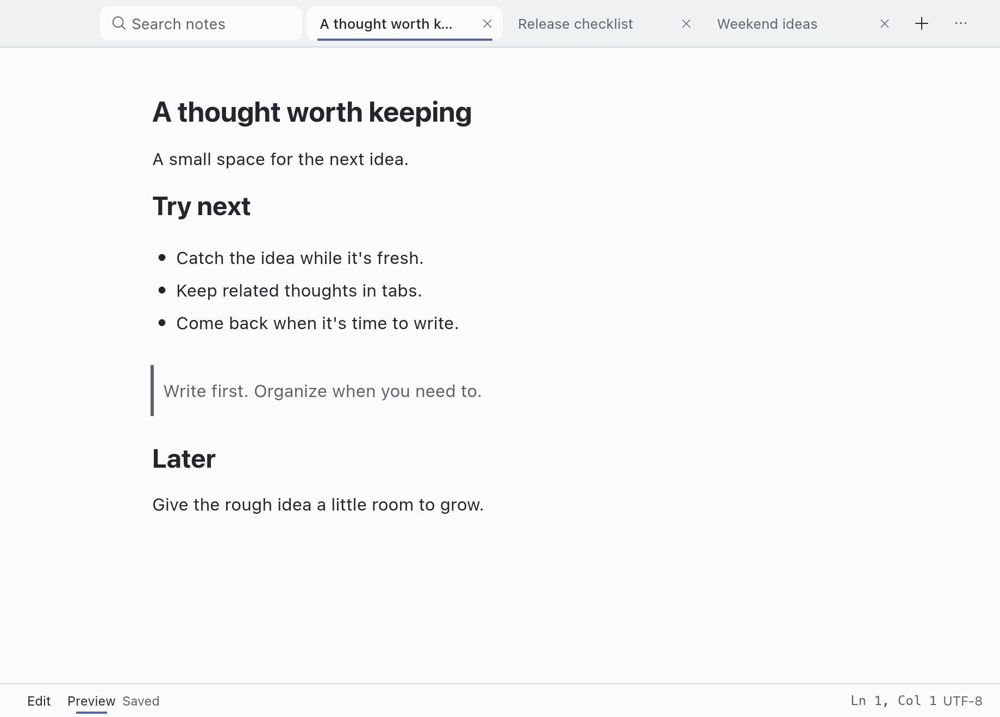
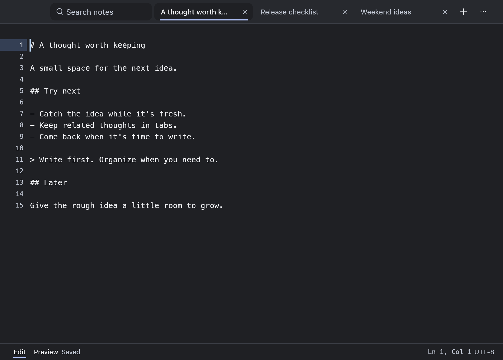

<a id="readme-top"></a>

<div align="center">
  
  <h1>Quick Note</h1>
  <p>기기에 저장하는 작은 노트 앱. 열고 바로 적어요.</p>
  <p><a href="README.md" lang="en">English</a> &middot; <strong>한국어</strong></p>
  <p>
    <a href="https://github.com/kitae0522/quick-note/releases/tag/v0.2.0-alpha.1"><strong>알파 다운로드</strong></a>
    &middot;
    <a href="docs/user-guide.md">사용 가이드</a>
    &middot;
    <a href="https://github.com/kitae0522/quick-note/issues/new">문제 제보</a>
  </p>
  <p>
    <a href="https://github.com/kitae0522/quick-note/actions/workflows/ci.yml"></a>
    <a href="LICENSE"></a>
  </p>
</div>

<details>
  <summary>목차</summary>

- [소개](#소개)
- [시작하기](#시작하기)
- [사용법](#사용법)
- [사용자 설정](#사용자-설정)
- [로드맵](#로드맵)
- [기여하기](#기여하기)
- [라이선스](#라이선스)
- [참고한 프로젝트와 저작자](#참고한-프로젝트와-저작자)

</details>

## 소개

아이디어가 떠오르면 바로 적을 수 있어야 해요. Quick Note는 처음 열면 바로 쓸 수 있는
빈 노트를 준비해요. 다시 열면 마지막 노트와 커서 위치를 복원하고,
입력할 때마다 기기의 SQLite 데이터베이스에 저장해요.

[](docs/images/editor.png)

<p>
  <a href="docs/images/markdown.png"></a>
  <a href="docs/images/editor-dark.png"></a>
</p>

*macOS 앱의 영문 UI에서 샘플 노트를 캡처했어요. 이미지를 누르면 원본 크기로 볼 수 있어요.*

- 모든 노트를 하나의 간결한 탭 목록에서 관리하고, 끌어서 순서를 바꿀 수 있어요.
- 전체 노트를 검색하거나 현재 노트에서 텍스트를 찾고 바꿀 수 있어요.
- 줄 번호, 현재 줄 표시와 자동 괄호 완성으로 글을 편하게 작성해요.
- 원문과 Markdown 미리보기를 오가거나 Markdown 기능을 끌 수 있어요.
- 설치된 글꼴을 순서대로 적용하고, JSON 테마와 단축키 설정을 공유할 수 있어요.
- UI는 영어와 한국어를 지원해요. 노트 저장과 내보내기는 UTF-8을 사용해요.

[Rust](https://www.rust-lang.org/), [egui / eframe](https://github.com/emilk/egui),
[SQLite](https://www.sqlite.org/)로 만들었어요. 계정이나 웹뷰 없이 실행해요.

## 시작하기

### 다운로드

첫 공개 버전은 **v0.2.0-alpha.1**이에요.

| 플랫폼 | 다운로드 | 설치 방법 |
| --- | --- | --- |
| macOS 14 이상, Apple Silicon | [macOS ZIP](https://github.com/kitae0522/quick-note/releases/download/v0.2.0-alpha.1/Quick-Note-macos-arm64.zip) | 압축을 풀고 `Quick Note.app`을 응용 프로그램 폴더로 옮겨요. |
| Windows, x86-64, 실험적 지원 | [Windows ZIP](https://github.com/kitae0522/quick-note/releases/download/v0.2.0-alpha.1/Quick-Note-windows-x86_64.zip) | ZIP 전체를 푼 뒤 `Quick Note.exe`를 실행해요. |

현재 제한사항은 [릴리스 노트](https://github.com/kitae0522/quick-note/releases/tag/v0.2.0-alpha.1)에서
확인할 수 있어요. 다운로드 파일의 체크섬은
[SHA256SUMS](https://github.com/kitae0522/quick-note/releases/download/v0.2.0-alpha.1/SHA256SUMS)에 있어요.

두 패키지 모두 배포자 신원을 확인하는 서명이 없어요. macOS 앱은 로컬 임시 서명인
ad-hoc 서명을 사용하며 공증을 받지 않았어요. 실제 한글 입력기와 VoiceOver,
Windows의 창·입력 동작은 아직 직접 확인이 필요해요.
알파를 사용하기 전에 노트 데이터를 백업해 두세요.

### 소스에서 실행

Rust 1.95 이상과 해당 운영체제의 네이티브 빌드 도구가 필요해요.

```sh
git clone https://github.com/kitae0522/quick-note.git
cd quick-note
cargo run --locked --release
```

macOS 앱 번들, Windows C++ Build Tools, 다른 운영체제용 빌드와 포터블 패키지 제작은
[개발 가이드](docs/development.md#run-and-build)를 참고해 주세요.

## 사용법

앱을 열고 바로 입력하세요. 창을 닫거나 앱을 종료해도 노트는 남아 있어요.

| 동작 | macOS | Windows |
| --- | --- | --- |
| 새 노트 | Cmd+N | Ctrl+N |
| 전체 노트 검색 | Cmd+P | Ctrl+P |
| 현재 노트에서 찾기 | Cmd+F | Ctrl+F |
| 현재 노트에서 바꾸기 | Cmd+Option+F | Ctrl+Alt+F |
| Markdown 미리보기 전환 | Cmd+Shift+M | Ctrl+Shift+M |
| 현재 노트 삭제 | Cmd+W | Ctrl+W |
| 노트를 유지하고 창 닫기 | Cmd+Shift+W | Ctrl+Shift+W |
| 설정 | Cmd+, | Ctrl+, |

**Cmd/Ctrl+W는 현재 노트를 삭제하는 단축키예요.** 빈 노트는 바로 삭제하고,
내용이 있는 노트는 확인을 받아요. 설정 화면에서 누르면 작성하던 노트로 돌아가요.
편집 중 Tab은 공백 네 칸을 넣어요. F6으로 편집기와 탭 사이의 포커스를 옮기고,
Esc로 패널을 닫아 글쓰기로 돌아갈 수 있어요.

전체 기본 단축키, 탭 이동, 찾기·바꾸기, Markdown 동작과 저장 실패 시 복구 방법은
[사용 가이드](docs/user-guide.md)에서 확인할 수 있어요. 상세 문서는 영문으로 제공해요.

### 노트 저장 위치

| 플랫폼 | 데이터 폴더 |
| --- | --- |
| macOS | `~/Library/Application Support/Quick Note/` |
| Windows | `%LOCALAPPDATA%\Quick Note\` |

노트를 백업하려면 앱을 종료한 뒤 데이터 폴더 전체를 복사하세요.
저장에 실패하면 편집기에 내용을 유지하고 노트 전환과 창 닫기를 막아요.
저장을 다시 시도하거나 사본을 내보낼 수 있어요. 데이터를 옮기거나 복구 동작을
시험하기 전에 [저장과 복구](docs/user-guide.md#storage-and-recovery)를 읽어 주세요.

## 사용자 설정

Cmd/Ctrl+,로 설정을 열어요. 설정은 앱을 다시 실행해도 유지돼요.

| 설정 | 바꿀 수 있는 항목 | 참고 문서 |
| --- | --- | --- |
| 모양 | 색상, 여백, 편집기 크기와 JSON 테마 파일 | [테마](docs/themes.md) |
| 글꼴 | 설치된 글꼴, 대체 순서와 여러 문자 체계의 미리보기 | [글꼴 설정](docs/user-guide.md#themes) |
| 언어 | English / 한국어 선택과 UTF-8 JSON 문구 수정 | [현지화](i18n/README.md) |
| 단축키 | `shortcut/bindings.json`의 동작별 키 설정 | [단축키 설정](shortcut/README.md) |
| Markdown과 모션 | 미리보기 지원과 모션 줄이기 | [사용 가이드](docs/user-guide.md) |

## 로드맵

알파의 다음 우선순위는 검증과 배포예요.

- [ ] macOS에서 실제 한글 입력기와 VoiceOver 검증하기
- [ ] Windows 데스크톱에서 입력, 접근성과 창 동작 검증하기
- [ ] macOS Developer ID 서명·공증과 Windows 코드 서명 추가하기
- [ ] 시작 시간 줄이기. **200ms는 목표예요. 실제로는 더 오래 걸릴 수 있어요.**

버그나 개선 제안은 [GitHub Issues](https://github.com/kitae0522/quick-note/issues)에 남겨 주세요.
성능 측정 방법과 한계는 [개발 가이드](docs/development.md#verification-and-speed)에 정리해 뒀어요.

## 기여하기

버그를 제보할 때는 앱 버전, 운영체제, 재현 순서와 짧은 입력 예시를 알려 주세요.
코드를 기여하려면 저장소를 포크하고 브랜치를 만든 뒤, 하나의 목적에 집중한 변경으로 PR을 열어 주세요.

[Rust 작성 규칙](docs/rust-style.md)을 따라 주세요. 직접 작성하는 소스 파일은
파일당 250줄 이하로 유지하고, `vendor/`의 외부 라이브러리는 원래 구조를 유지해요.
테스트는 별도 데이터로 실행하고, 저장의 원자성, UTF-8 텍스트와 실패 시 복구 동작을 보존해 주세요.

코드를 제출하기 전에 기본 검사를 실행해 주세요.

```sh
./scripts/check.sh
```

[개발 가이드](docs/development.md)에 GUI 검사, 릴리스 빌드, 시작 시간 측정과 CPU·메모리 측정 방법이 있어요.
자동 입력 재현과 별도로 실제 한글 입력기와 화면 읽기 프로그램을 직접 테스트해야 해요.

## 라이선스

Quick Note 자체 코드는 [MIT 라이선스](LICENSE)를 따라요.
외부 라이브러리, 글꼴과 아이콘은 각자의 라이선스를 유지해요.
[외부 저작물 고지](assets/licenses/README.md)를 참고해 주세요.
릴리스 패키지의 `Licenses` 폴더에도 고지를 포함했어요.

## 참고한 프로젝트와 저작자

- 간결한 탭과 작성 중인 내용을 유지하는 흐름은 Helium과 Sublime Text에서 영감을 얻었어요.
- 글꼴과 아이콘의 저작자는 [저작물 고지](assets/licenses/README.md)에 적었어요.
- README 구조는 [Best-README-Template](https://github.com/othneildrew/Best-README-Template)을 참고했어요.

<p align="right"><a href="#readme-top">맨 위로</a></p>
